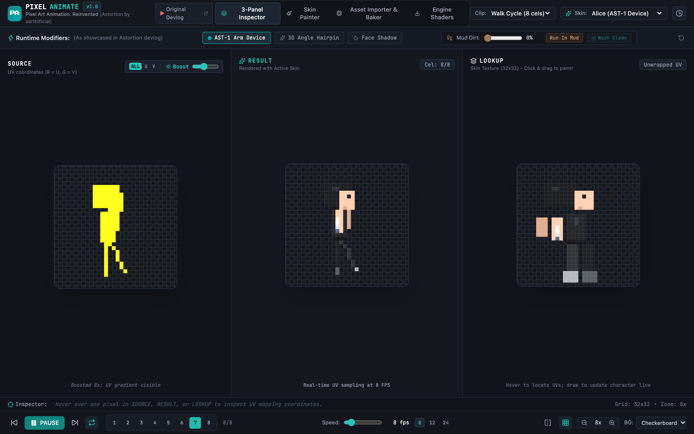
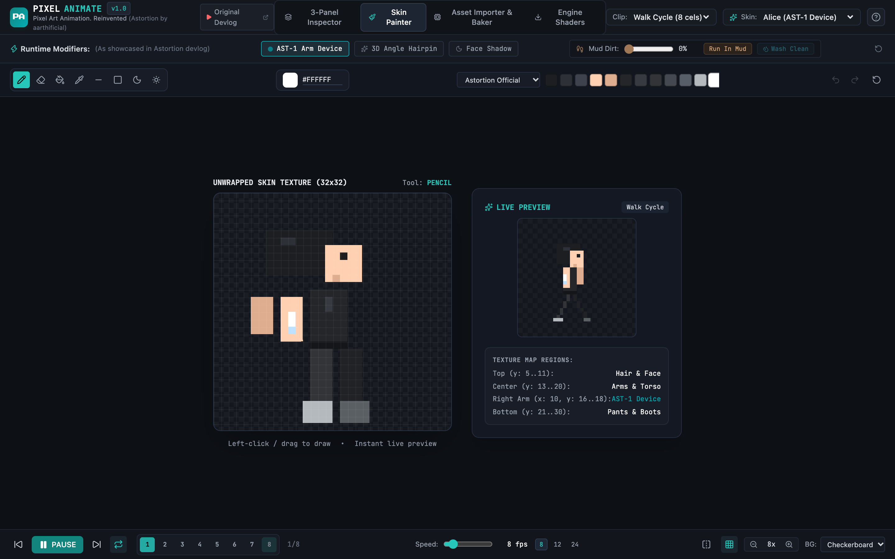
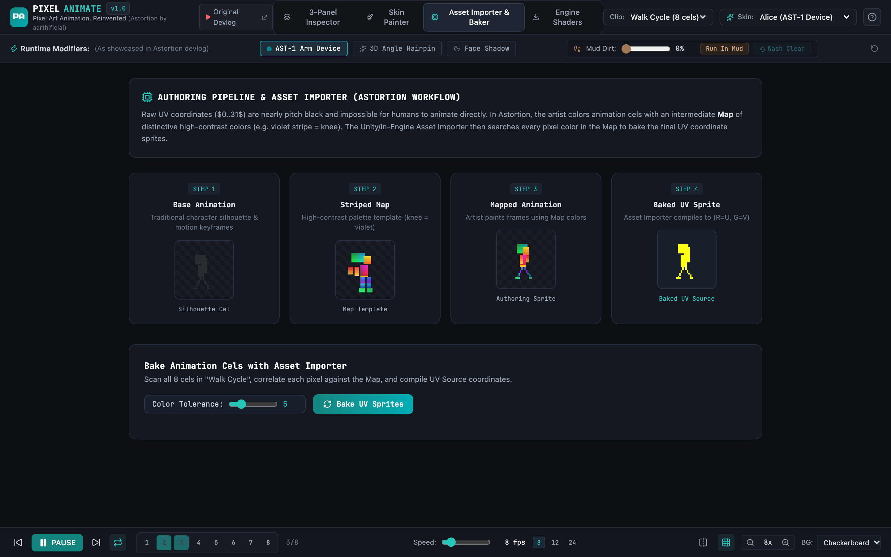
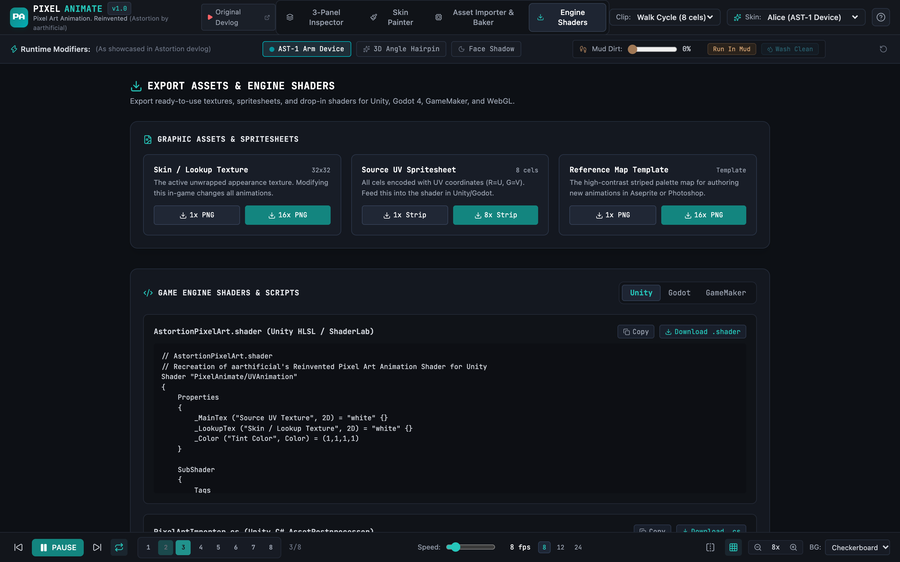

# PixelAnimate: Pixel Art Animation. Reinvented

> A browser studio that implements the 2D UV-mapped pixel art animation technique designed by **aarthificial** for the indie game **Astortion** ([YouTube Devlog](https://youtu.be/HsOKwUwL1bE)).

[**Live demo**](https://siddhu-123.github.io/pixelanimate/) · [Features](#-features--capabilities) · [Quick start](#-quick-start) · [Known limitations](#-known-limitations)




> **Unofficial fan project.** It is not affiliated with or endorsed by aarthificial or Astortion. The character and skin names refer to the Astortion devlog the technique was demonstrated in; the code and pixel data here were written for this project.

| Skin Painter | Asset Importer & Baker | Engine Exporters |
|---|---|---|
|  |  |  |

---

## 💡 The Core Concept

In traditional pixel art animation, changing a character's clothing, equipment, lighting, or skin requires redrawing every cel of every animation. In 3D animation, this problem is solved by separating the **mesh/appearance** from the **bones/motion**.

**PixelAnimate** achieves that exact separation in pure 2D pixel art:

1. **Source Animation**: Each pixel in an animation cel stores **UV coordinates** instead of visual colors:
   - **Red Channel**: $U$ coordinate ($X$ position in Lookup Texture)
   - **Green Channel**: $V$ coordinate ($Y$ position in Lookup Texture)
   - **Alpha Channel**: Visibility (opaque vs transparent)
2. **Lookup Texture (Skin)**: An unwrapped 2D texture (e.g. $32 \times 32$) mapping character features (hair, face, eyes, arms, AST-1 device, torso, legs, boots).
3. **Hardware Shader**: Samples $(U, V)$ from the Source Animation, then samples the Lookup Texture at $(U, V)$ to render the final visual color.
4. **Intermediate Map & Pipeline**: Because raw UV values are indistinguishable dark pixels ($0..31$), animators draw using an intermediate **Map** with high-contrast, striped colors (e.g. violet stripe = knee). An **Asset Importer** compiles these Mapped frames into baked UV Source textures.

---

## ✨ Features & Capabilities

### 1. 3-Panel Synchronized Inspector (Exact Devlog UI)
- **SOURCE Panel**:
  - Displays the UV coordinate frames.
  - **Brightness Boost**: Amplifies dark UV coordinate values ($0..31$) to full visible spectrum ($0..255$) so animators can visually inspect coordinate gradients (exactly as demonstrated by aarthificial).
  - **Channel Isolation**: Isolate All UV, U (Red / X) channel only, or V (Green / Y) channel only.
- **RESULT Panel**:
  - Live animated character rendered with the active Lookup Texture in real-time.
  - Controls: Play, Pause, Step Forward/Backward, FPS Slider ($1 - 60$ FPS), Loop, Flip Horizontal.
  - Zoom levels ($1\times$ to $24\times$), Pixel Grid toggle, Viewport backgrounds (Dark, Astortion Teal, Checkerboard, Clean White, Green Screen).
- **LOOKUP Panel**:
  - Displays the $32 \times 32$ unwrapped appearance texture.
- **Bidirectional UV Cross-Highlighting**:
  - Hovering or clicking on any pixel in the character sprite immediately highlights the corresponding coordinate on the Lookup texture with coordinates readout.
  - Hovering on the Lookup texture highlights every pixel on the character that references that UV spot!

### 2. Real-Time Dynamic Runtime Effects (Devlog Showcase)
- **AST-1 Arm Device Toggle**: Instantly equip or unequip Alice's gravity-distortion white device on her right arm.
- **3D Angle-Dependent Details**: Toggle asymmetric accessories (e.g. hairpin) visible only from specific viewing angles.
- **Dynamic Mud / Dirt Simulation**:
  - Running through mud accumulates dirt on shoes and pants in real-time.
  - Interactive dirt slider and "Run in Mud" simulation loop.
- **Dynamic Water Cleaning**:
  - "Wash Clean" simulation that washes dirt off the character in real-time.
- **Face Shadows & Directional Lighting**:
  - Toggle dramatic face and neck shadows across all animation frames simultaneously.

### 3. Interactive In-Game Skin Painter
- Paint directly onto the Lookup Texture with **zero-latency real-time animation updates**:
  - Tools: Pencil, Eraser, Fill Bucket (Flood Fill), Color Eyedropper, Line, Rectangle, Shading brushes (Darken / Lighten).
  - Preset Palettes: Astortion Official, PICO-8, Endesga 32.
  - Multi-level Undo & Redo (`Ctrl+Z`, `Ctrl+Y`).
  - Bundled Preset Skins:
    - *Alice Classic (AST-1 Device)*
    - *Alice Prologue (Pre-AST-1)*
    - *Casual White Shirt / Khaki Pants*
    - *Stealth Infiltrator (Midnight suit & cyan visor)*
    - *Cyberpunk Suit (Neon power conduits)*

### 4. Authoring Pipeline & Asset Importer
- **Striped Map Reference**: High-contrast palette map where features like knees, elbows, and torso have distinct striped colors.
- **Asset Importer & UV Baker**:
  - Automatically correlates Mapped animation cels against the Map template.
  - Euclidean color tolerance threshold matching.
  - Diagnostics: unmatched pixel detection, error highlights, and conversion statistics.
  - Export baked UV spritesheets directly from browser.

### 5. Multi-Engine Exporters & Scripts
- **Unity**: Custom HLSL ShaderLab shader (`engines/unity/AstortionPixelArt.shader`) + C# Asset Postprocessor (`engines/unity/PixelArtImporter.cs`).
- **Godot 4**: Godot CanvasItem shader (`engines/godot/astortion_uv.gdshader`).
- **GameMaker**: Fragment shader (`engines/gamemaker/shd_rpaa.fsh`) + GML draw script (`engines/gamemaker/rpaa_draw.gml`).
- **Python CLI Tools**:
  - `scripts/bake_uv.py`: Headless command-line UV compiler.
  - `scripts/generate_map.py`: Headless command-line striped map generator.

---

## 🚀 Quick Start

### Web Studio

1. **Install dependencies** (Node.js 22+):
   ```bash
   git clone https://github.com/Siddhu-123/pixelanimate.git
   cd pixelanimate
   npm install
   ```

2. **Start development server**:
   ```bash
   npm run dev
   ```
   Open `http://localhost:5173` in your browser.

3. **Build for production**:
   ```bash
   npm run build
   ```
   To deploy under a sub-path (as GitHub Pages does), set `BASE_PATH`, for example `BASE_PATH=/pixelanimate/ npm run build`. The included workflow in `.github/workflows/pages.yml` does this on every push to `main`.

### Command Line Tools

- **Bake an animation into UV coordinates**:
  ```bash
  python3 scripts/bake_uv.py --map map_template.png --input mapped_spritesheet.png --output baked_uv.png --tolerance 5
  ```

- **Generate a new striped reference Map**:
  ```bash
  python3 scripts/generate_map.py --width 32 --height 32 --output my_map.png
  ```

---

## 🎮 Keyboard Shortcuts

| Key | Action |
| --- | --- |
| `Space` | Play / Pause Animation |
| `←` / `→` | Step Backward / Forward by Cel |
| `1` | Switch to 3-Panel Inspector |
| `2` | Switch to Skin Painter Studio |
| `3` | Switch to Asset Importer & Baker |
| `4` | Switch to Engine Exporters |
| `Ctrl+Z` / `Ctrl+Y` | Undo / Redo in Skin Painter |

---

## 🧱 Tech Stack

React 19 · TypeScript · Vite · Tailwind CSS 4 · lucide-react. The engine code (UV compiler, shader sampler, effects, map generator) is plain TypeScript under `src/engine`; the CLI tools are standalone Python scripts under `scripts/`.

## ⚠️ Known Limitations

- U/V values are stored in 8 bits, so lookup textures larger than 256 px wrap or clip (affects both `UVCompiler.ts` and `scripts/bake_uv.py`).
- `scripts/generate_map.py` builds its striped palette in HSV while the web app uses HSL, so maps generated by the two paths differ.
- The runtime-effects bar recreates its timers on every tick (performance only).

## 📜 Credits

- Original concept and devlog: **aarthificial** ([YouTube](https://youtu.be/HsOKwUwL1bE))
- Featured game: **Astortion**

## License

[MIT](LICENSE) © 2026 Satya Siddhartha Balanagu
